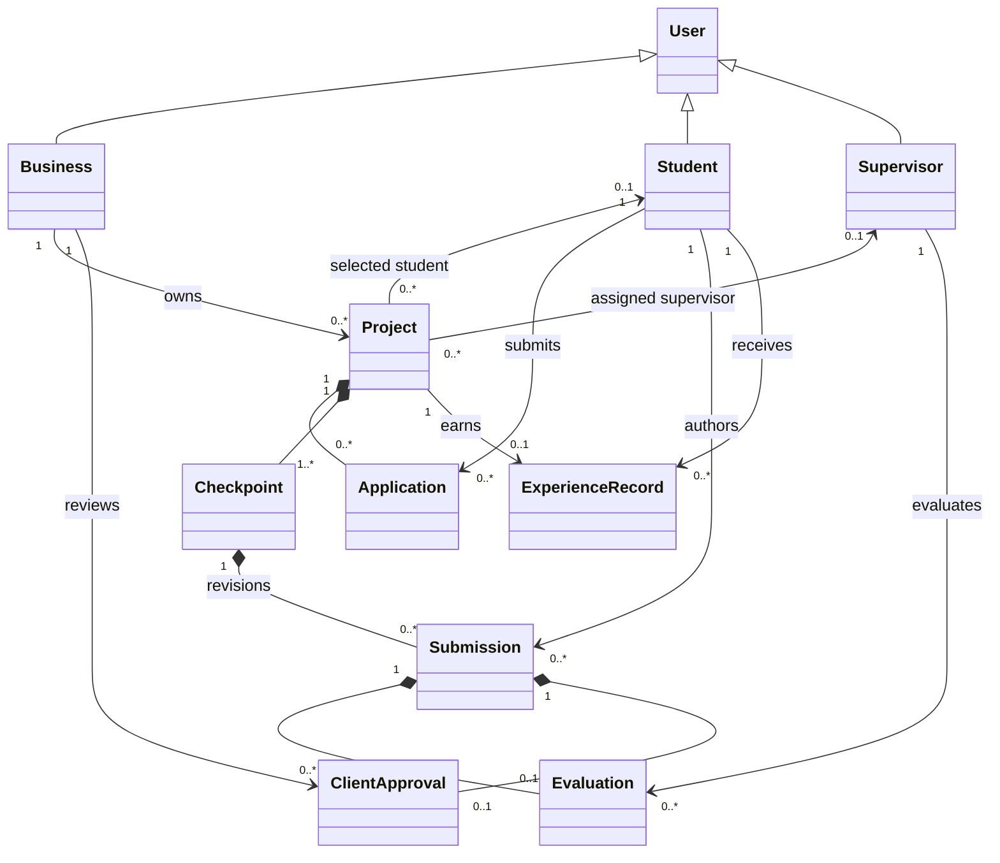
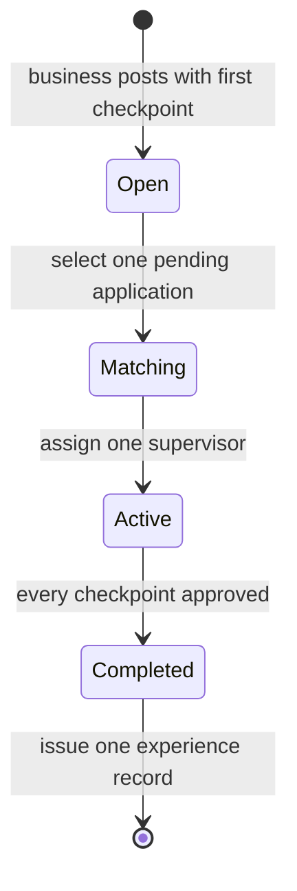
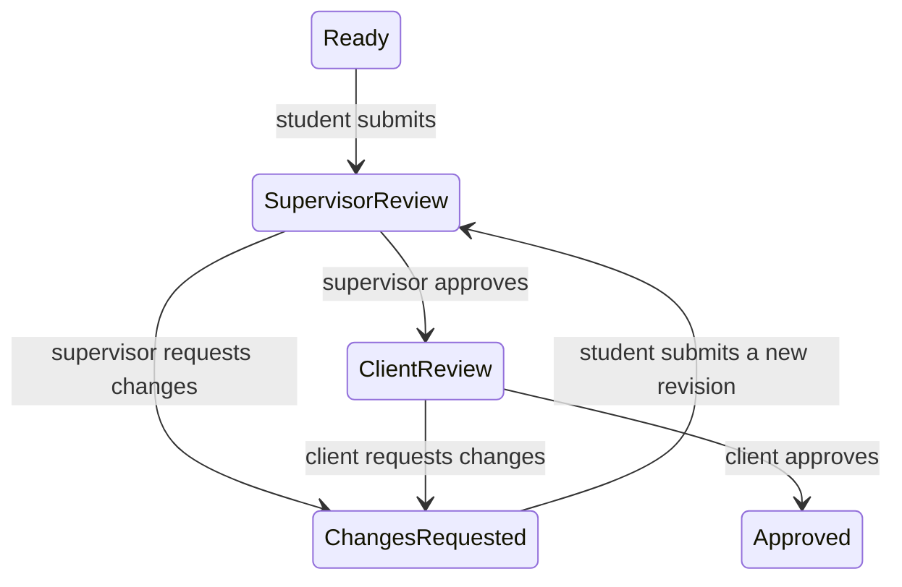

# SymbioNet — implemented Model A

The current request establishes one student and one supervisor per project. Both are optional while recruiting, then exactly one of each is required before work begins. Applications, submissions, evaluations, and approvals are separate concepts even though the modest browser data model nests them in their project.

`Business`, `Student`, and `Supervisor` are represented by the `role` discriminator on users. A business user stands for a single client organization in this prototype. A person may participate in multiple projects; there is no capacity limit. The business owner manually selects and assigns the team; there is no separate administrator or supervisor acceptance flow.

## Lifecycle

Checkpoints have derived states rather than a separately editable status:

## Constraints implemented in domain.js

1. Every project has exactly one owning business and at least one checkpoint.
2. Only students apply; a student can apply once per project, and only while it is open.
3. Only the owner selects an applicant. Exactly one accepted application determines `studentId`; all others become `not_selected`. Selection is not replaceable in the MVP.
4. A project in `matching` has one student and no supervisor. Only its owner can assign a valid supervisor, once. Assignment starts the project.
5. Active and completed projects have exactly one selected student and one assigned supervisor. There are no teams or shared supervisors within a single project.
6. Only the selected student submits. Only the assigned supervisor evaluates. Only the owning business gives client approval.
7. Only the latest submission is actionable. A submission gets at most one supervisor evaluation and at most one client decision. Client review requires an approving supervisor evaluation for that same submission.
8. A change request by either reviewer enables a new submission and preserves earlier work and feedback. Both review stages run again. In-review and approved work cannot be overwritten.
9. Evaluations have a 1–5 integer score, an approve/request-changes decision, and feedback. Client decisions also require feedback. The model does not infer approval from a numeric score.
10. Checkpoints can proceed independently. All must be client-approved to complete the project. The owner can add checkpoints only until the first submission; no removal or post-submission scope changes are supported.
11. Completion automatically creates exactly one experience record for the selected student. It snapshots final approved evidence, participants, skills, completion date, and average supervisor rating. Completed projects are immutable through the workflow.
12. Each command clones state and returns the next state only after successful validation; failures do not partially change the current state. URLs allow HTTP(S) only, without embedded credentials. Required text is bounded, dates must be real calendar dates, and rendered user text is escaped.

Experience records use `verification: demo-workflow-only`. These invariants describe demo behavior; browser-local checks and storage are not security boundaries.
